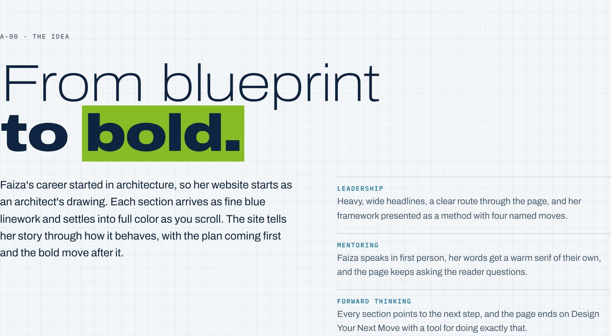

# A-00 · The idea

## From blueprint to bold

Faiza's career started in architecture, so her website starts as an architect's
drawing. Each section arrives as fine blue linework and settles into full colour as you
scroll. The site tells her story through how it behaves, with the plan coming first and
the bold move after it.

## What the brief asked for

The site had to feel modern and convey three things without having to say them.

| Quality | How the concept carries it |
| --- | --- |
| **Leadership** | Heavy, wide headlines, a clear route through the page, and her framework presented as a method with four named moves. |
| **Mentoring** | Faiza speaks in the first person, her words get a warm serif of their own, and the page keeps asking the reader questions. |
| **Forward thinking** | Every section points to the next step, and the page ends on *Design Your Next Move* with a tool for doing exactly that. |

---

Next: [A-01 · Homepage, two states](02-homepage-two-states.md)
