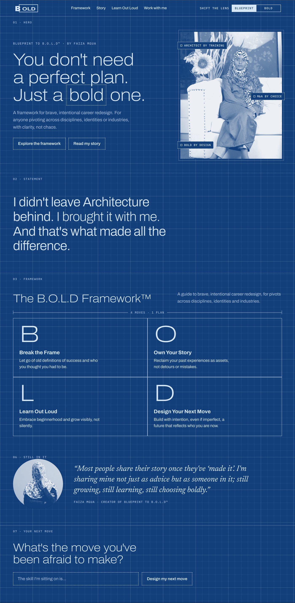
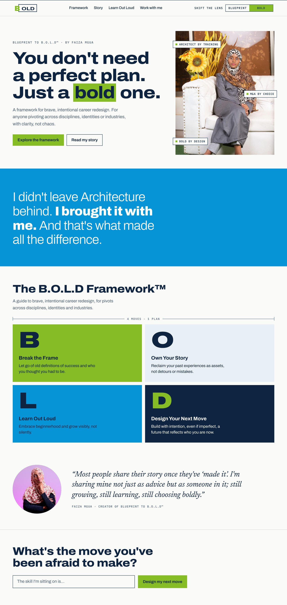

# A-01 · Homepage, two states

The board's mock-up has a switch in its menu bar that flips between Blueprint and Bold.
On the proposed live site, every section would start as the blueprint and turn bold as it
scrolled into view.

| Blueprint | Bold |
| --- | --- |
|  |  |

The mock-up was a mock-up only. Its copy comes from the PDF; the three photo notes are
suggested lines. Sections 04 Story, 05 Lessons and 08 Footer weren't drawn.

## What the mock-up shows

**Menu bar.** The B.O.L.D monogram; links to Framework, Story, Learn Out Loud and Work
with me; and the *Shift the lens* switch (Blueprint | Bold). The address bar reads
`blueprinttobold.com`.

**01 · Hero**

- Kicker: *Blueprint to B.O.L.D™ · by Faiza Mgua*
- Headline: **You don't need a perfect plan. Just a bold one.** The word *bold* is
  highlighted.
- Lead: *A framework for brave, intentional career redesign. For anyone pivoting across
  disciplines, identities or industries, with clarity, not chaos.*
- Buttons: *Explore the framework* and *Read my story*.
- Portrait with three margin notes: *Architect by training*, *M&A by choice*,
  *Bold by design*.

**02 · Statement.** *I didn't leave Architecture behind. I brought it with me. And that's
what made all the difference.*

**03 · Framework.** *The B.O.L.D Framework™*, a guide to brave, intentional career
redesign, for pivots across disciplines, identities and industries. A dimension line
reads *4 moves · 1 plan* above four rooms:

| | Move | What it means |
| --- | --- | --- |
| **B** | Break the Frame | Let go of old definitions of success and who you thought you had to be. |
| **O** | Own Your Story | Reclaim your past experiences as assets, not detours or mistakes. |
| **L** | Learn Out Loud | Embrace beginnerhood and grow visibly, not silently. |
| **D** | Design Your Next Move | Build with intention, even if imperfect, a future that reflects who you are now. |

**06 · Still in it.** Beside the second portrait: *"Most people share their story once
they've 'made it'. I'm sharing mine not just as advice but as someone in it; still
growing, still learning, still choosing boldly."* Faiza Mgua · Creator of Blueprint to
B.O.L.D™

**07 · Your next move.** *What's the move you've been afraid to make?* A field (*The
skill I'm sitting on is…*) and a button (*Design my next move*).

## How the two states differ

| | Blueprint | Bold |
| --- | --- | --- |
| Ground | Cyanotype blue with a drafting grid | Drafting paper |
| Text and lines | Pale blue linework | Blueprint ink |
| Headlines | Hairline weight | Heavy weight |
| Highlight on *bold* | Dashed outline | Solid green fill |
| Buttons and fields | Dashed outlines, no fill | Solid outlines; the main action filled green |
| Framework rooms | Outlined rooms on the grid | Filled rooms: B green, O pale, L blue, D ink |
| Photos | Grayscale, printed as a cyanotype | Full colour |
| Margin notes | Dashed tags | Solid tags with a green square |

---

Previous: [A-00 · The idea](01-the-idea.md) · Next: [A-02 · How the homepage reads](03-how-the-homepage-reads.md)
