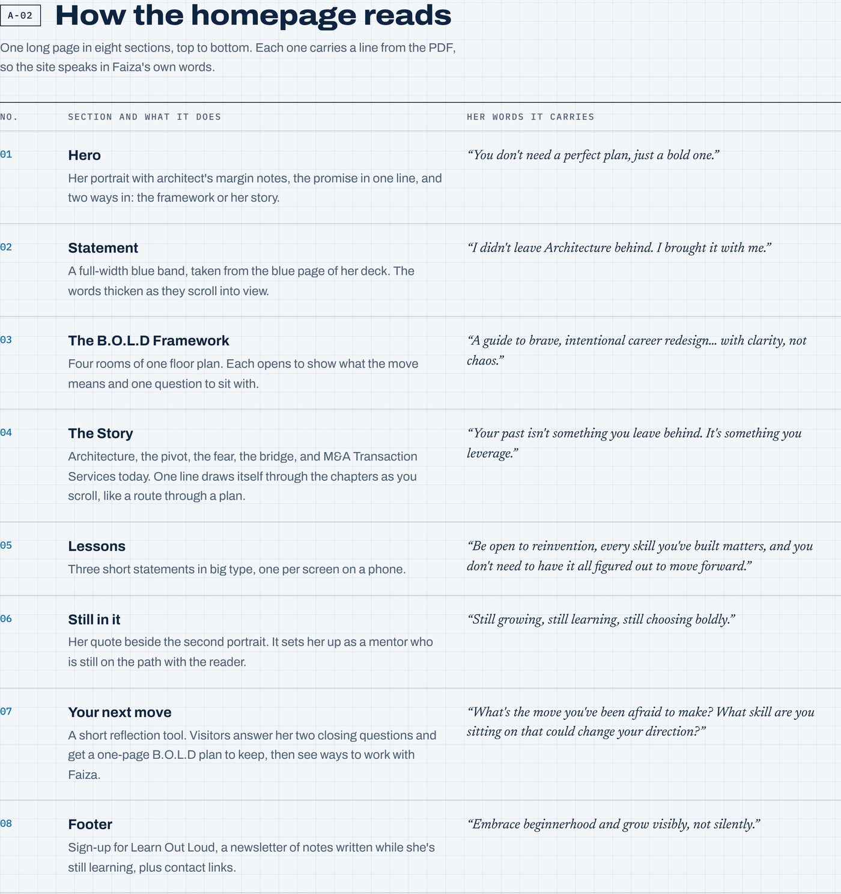

# A-02 · How the homepage reads

One long page in eight sections, top to bottom. Each one carries a line from the PDF,
so the site speaks in Faiza's own words.

| No. | Section | What it does | Her words it carries |
| --- | --- | --- | --- |
| 01 | **Hero** | Her portrait with architect's margin notes, the promise in one line, and two ways in: the framework or her story. | "You don't need a perfect plan, just a bold one." |
| 02 | **Statement** | A full-width blue band, taken from the blue page of her deck. The words thicken as they scroll into view. | "I didn't leave Architecture behind. I brought it with me." |
| 03 | **The B.O.L.D Framework** | Four rooms of one floor plan. Each opens to show what the move means and one question to sit with. | "A guide to brave, intentional career redesign… with clarity, not chaos." |
| 04 | **The Story** | Architecture, the pivot, the fear, the bridge, and M&A Transaction Services today. One line draws itself through the chapters as you scroll, like a route through a plan. | "Your past isn't something you leave behind. It's something you leverage." |
| 05 | **Lessons** | Three short statements in big type, one per screen on a phone. | "Be open to reinvention, every skill you've built matters, and you don't need to have it all figured out to move forward." |
| 06 | **Still in it** | Her quote beside the second portrait. It sets her up as a mentor who is still on the path with the reader. | "Still growing, still learning, still choosing boldly." |
| 07 | **Your next move** | A short reflection tool. Visitors answer her two closing questions and get a one-page B.O.L.D plan to keep, then see ways to work with Faiza. | "What's the move you've been afraid to make? What skill are you sitting on that could change your direction?" |
| 08 | **Footer** | Sign-up for *Learn Out Loud*, a newsletter of notes written while she's still learning, plus contact links. | "Embrace beginnerhood and grow visibly, not silently." |

---

Previous: [A-01 · Homepage, two states](02-homepage-two-states.md) · Next: [A-03 · Look and feel](04-look-and-feel.md)
