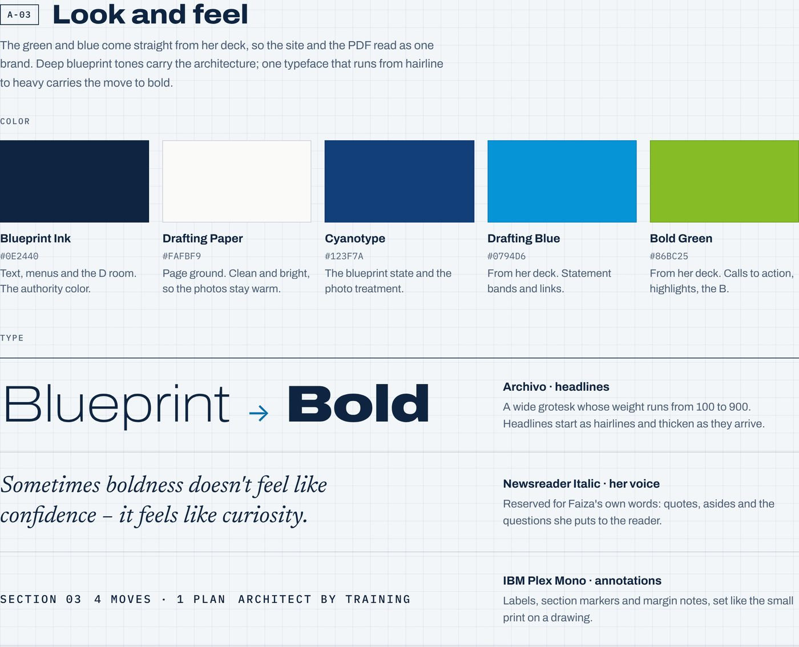

# A-03 · Look and feel

The green and blue come straight from her deck, so the site and the PDF read as one
brand. Deep blueprint tones carry the architecture; one typeface that runs from hairline
to heavy carries the move to bold.

## Colour

| Name | Hex | Role |
| --- | --- | --- |
| Blueprint Ink | `#0E2440` | Text, menus and the D room. The authority colour. |
| Drafting Paper | `#FAFBF9` | Page ground. Clean and bright, so the photos stay warm. |
| Cyanotype | `#123F7A` | The blueprint state and the photo treatment. |
| Drafting Blue | `#0794D6` | From her deck. Statement bands and links. |
| Bold Green | `#86BC25` | From her deck. Calls to action, highlights, the B. |

## Type

| Family | Job | Notes |
| --- | --- | --- |
| **Archivo** | Headlines | A wide grotesk whose weight runs from 100 to 900. Headlines start as hairlines and thicken as they arrive: *Blueprint → **Bold***. |
| **Newsreader Italic** | Her voice | Reserved for Faiza's own words: quotes, asides and the questions she puts to the reader. Sample: *"Sometimes boldness doesn't feel like confidence – it feels like curiosity."* |
| **IBM Plex Mono** | Annotations | Labels, section markers and margin notes, set like the small print on a drawing. Sample: `SECTION 03` · `4 MOVES · 1 PLAN` · `ARCHITECT BY TRAINING` |

All three are free on Google Fonts.

---

Previous: [A-02 · How the homepage reads](03-how-the-homepage-reads.md) · Next: [A-04 · Signature details](05-signature-details.md)
