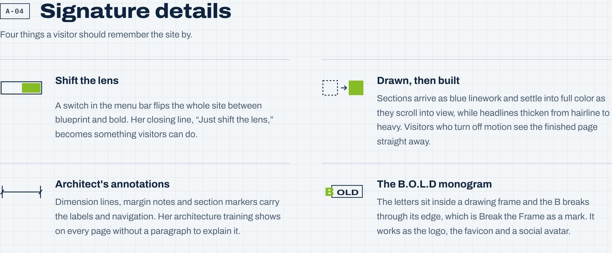

# A-04 · Signature details

Four things a visitor should remember the site by.

## Shift the lens

A switch in the menu bar flips the whole site between blueprint and bold. Her closing
line, "Just shift the lens," becomes something visitors can do.

## Drawn, then built

Sections arrive as blue linework and settle into full colour as they scroll into view,
while headlines thicken from hairline to heavy. Visitors who turn off motion see the
finished page straight away.

## Architect's annotations

Dimension lines, margin notes and section markers carry the labels and navigation. Her
architecture training shows on every page without a paragraph to explain it.

## The B.O.L.D monogram

The letters sit inside a drawing frame and the B breaks through its edge, which is
*Break the Frame* as a mark. It works as the logo, the favicon and a social avatar.

---

Previous: [A-03 · Look and feel](04-look-and-feel.md) · Next: [A-05 · Pages and build](06-pages-and-build.md)
