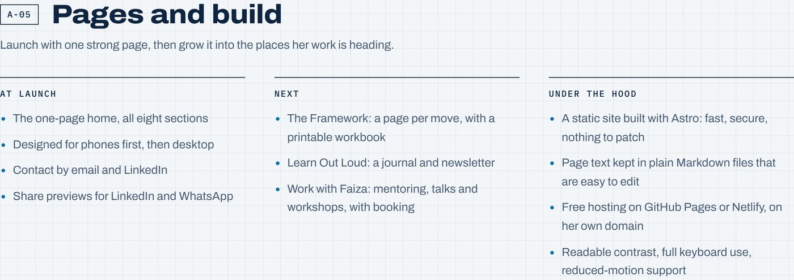

# A-05 · Pages and build

Launch with one strong page, then grow it into the places her work is heading.

## At launch

- The one-page home, all eight sections
- Designed for phones first, then desktop
- Contact by email and LinkedIn
- Share previews for LinkedIn and WhatsApp

## Next

- **The Framework:** a page per move, with a printable workbook
- **Learn Out Loud:** a journal and newsletter
- **Work with Faiza:** mentoring, talks and workshops, with booking

## Under the hood (as proposed)

- A static site built with Astro: fast, secure, nothing to patch
- Page text kept in plain Markdown files that are easy to edit
- Free hosting on GitHub Pages or Netlify, on her own domain
- Readable contrast, full keyboard use, reduced-motion support

The build took a simpler route. See [From concept to build](07-from-concept-to-build.md).

---

Previous: [A-04 · Signature details](05-signature-details.md) · Next: [From concept to build](07-from-concept-to-build.md)
